# 一二布布 · 一根绳拴在一起的双人闯关

一台电脑、一副键盘、两个人面对面的合作平台跳跃游戏；同一套画片另外还做了一个消消乐玩法。
Godot 4.7 写的，导出成**一个免安装的 exe**，双击就能玩，不用联网、不用装运行库。

> ⚠️ 形象版权：一二布布是别人的商业 IP，这里的素材是为个人学习/自娱做的衍生。
> 只适合自己在家玩，**不要发布、参赛或商用**。仓库以非商用条款提供，见文末[许可与免责](#许可与免责)。

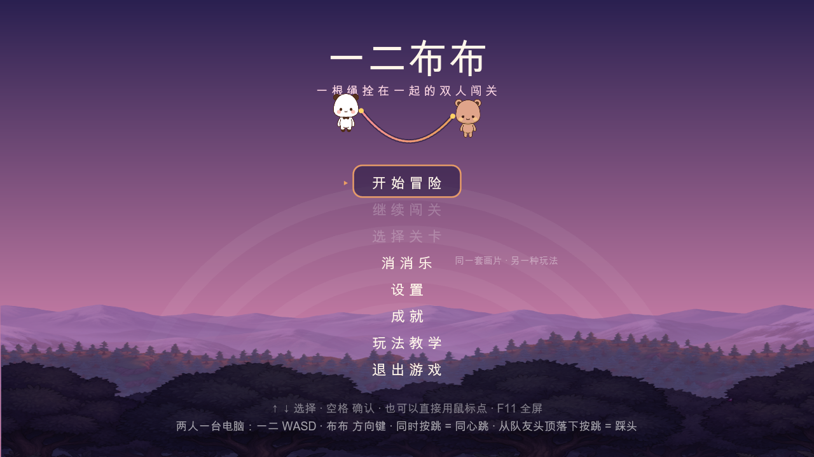

---

## 两种玩法，一套画片

| | 闯关模式 | 消消乐模式 |
| --- | --- | --- |
| 人数 | 2 人合作（同键盘，也可手柄 1 + 手柄 2） | 1 人（鼠标/触屏） |
| 体量 | 12 关 · 三幕 · 36 星 | 15 局 · 三段 · 45 星 |
| 核心 | 一根绳把两人拴在一起，绳会拽人、兜人、送人 | 换相邻两块凑三连，特殊块与冰块互相咬合 |
| 教学 | 每关开头一句话点破本关要用的动作 | 首页带六条图文规则，进局左下有提示 |

标题菜单八项：开始冒险 · 继续闯关 · 选择关卡 · 消消乐 · 设置 · 成就 · 玩法教学 · 退出游戏。

---

## 闯关：六个核心动作

绳子不是装饰，它是全部关卡的解题入口，六个动作一关一关教：

| 动作 | 怎么做 | 用来过什么 |
| --- | --- | --- |
| 绳子 | 拉直了会互相拽住 | 全部关卡的基础 |
| 同心跳 | 两人**同时**按跳 | 一个人绝对够不到的高台 |
| 踩头弹跳 | 一人蹲稳，另一人从他头顶落下的瞬间按跳 | 比同心跳更高的位置 |
| 沿绳攀爬 | 掉进坑里不会死，绳子兜住你；悬空时按住跳 | 深坑、失败后的补救 |
| 借绳甩出 | 荡到半空点一下跳 | 深谷 |
| 滑轮吊人 | 绳子搭上滑轮后不再是直线，地上那位往远处走 | 吊着队友越过封锁 |

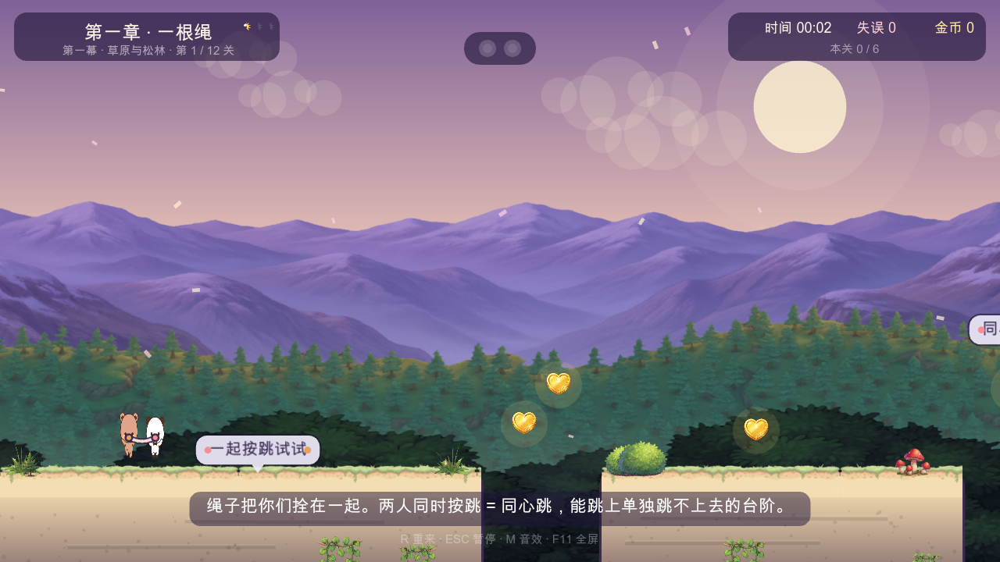
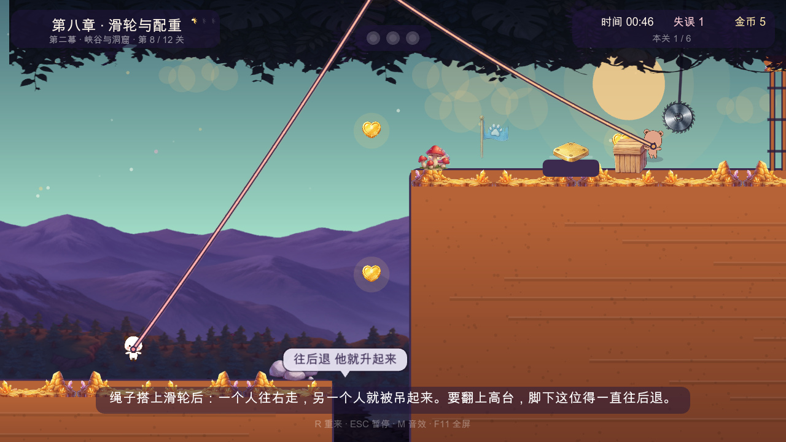

### 十二关 · 三幕

| 幕 | 关 | 名字 | 这一关新东西 |
| --- | --- | --- | --- |
| 一 · 草原与松林 | 1 | 一根绳 | 同心跳 |
| | 2 | 绳兜住你 | 跳坑、沿绳爬回、踩头弹跳 |
| | 3 | 尖牙与薄台 | 尖牙会碎、薄草台能从下面穿上去 |
| | 4 | 荡过深谷 | 借绳甩出 |
| 二 · 峡谷与洞窟 | 5 | 会碎的台阶 | 踩上去会塌，只能一直往前 |
| | 6 | 锋与风 | 来回锯片 + 能把人托起来的风柱 |
| | 7 | 木箱与按钮 | 木箱压按钮；绿点会卡住，黄点必须一直有人站 |
| | 8 | 滑轮与配重 | 滑轮吊人 + 木箱当配重 |
| 三 · 霜雪与归途 | 9 | 冰上刹车 | 冰面刹不住，要提前起跳 |
| | 10 | 风与绳 | 风柱送高，再靠绳子荡过去 |
| | 11 | 一起走 | 传送带会一直把你往前送 |
| | 12 | 一起到家 | 全部串起来 |

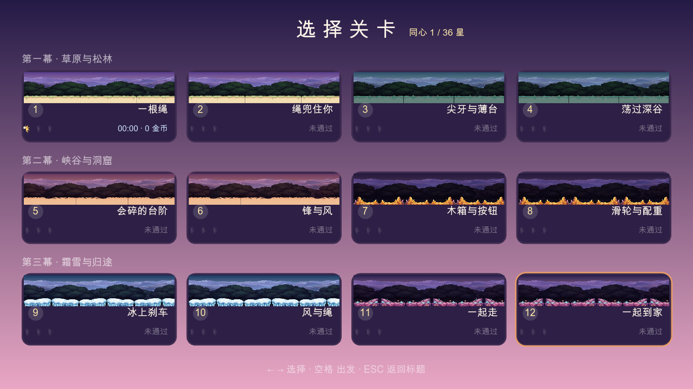
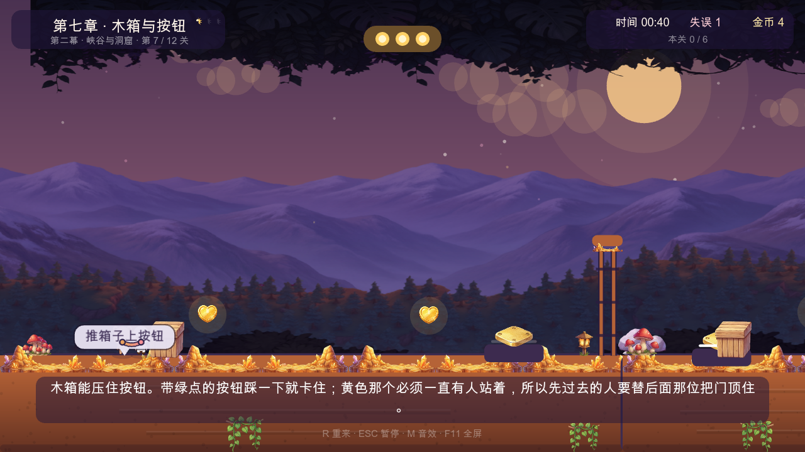

### 每关三颗星

1. 两人一起踩住门前**所有**压力板，再一起站进门里；
2. 捡光本关所有金币（金币数显示在右上角）；
3. 用时不超过本关目标时间（目标时间写在过关结算牌上）。

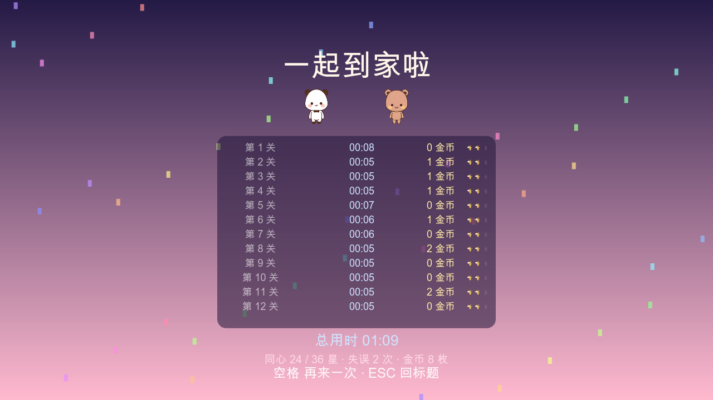
（这张里的 00:05 是自动跑关工具刷出来的用时，不是人打的。）

---

## 消消乐：同一套画片的另一种玩法

一二和布布本身就是一种"颜色"，另外七种是场景里的东西：金币、水晶、蘑菇、花、松塔、冰凌、樱花、竹节。

| 规则 | 说明 |
| --- | --- |
| 三连 | 换相邻两块，三个同色连成一线就消掉，上面补下来 |
| 连锁 | 补下来的块再连成线会继续消，连锁越深每块分越高（每层 +50%） |
| 爆破条 | 四个连成一排留下带箭头的块，炸开它所在的整行或整列 |
| 炸弹 | 拐个 L 形（横三条配竖三条），交点变炸弹，炸掉周围 3×3 |
| 彩虹球 | 五个连成一排留下一颗彩球；跟任意一块换位清掉那一整色，两颗对撞清空整盘 |
| 冰块 | 不能换也不能消，只能在它旁边消一次敲薄一层；厚冰要敲两下。冰还兼作"墙"——它不掉落也不让上面的东西掉落，一整列冰能把棋盘劈成两半 |
| 目标与步数 | 每局左栏写着要收齐的东西和步数，用完前收齐就过关 |
| 星 | 过关 1 星；分数过二星线 2 星，过三星线 3 星（门槛写在选局页和关卡里） |
| 死局 | 没有步可走时自动重排，绝不卡死 |

局内按键：`H` 提示一步 · `R` 重开本局 · `ESC` 返回。

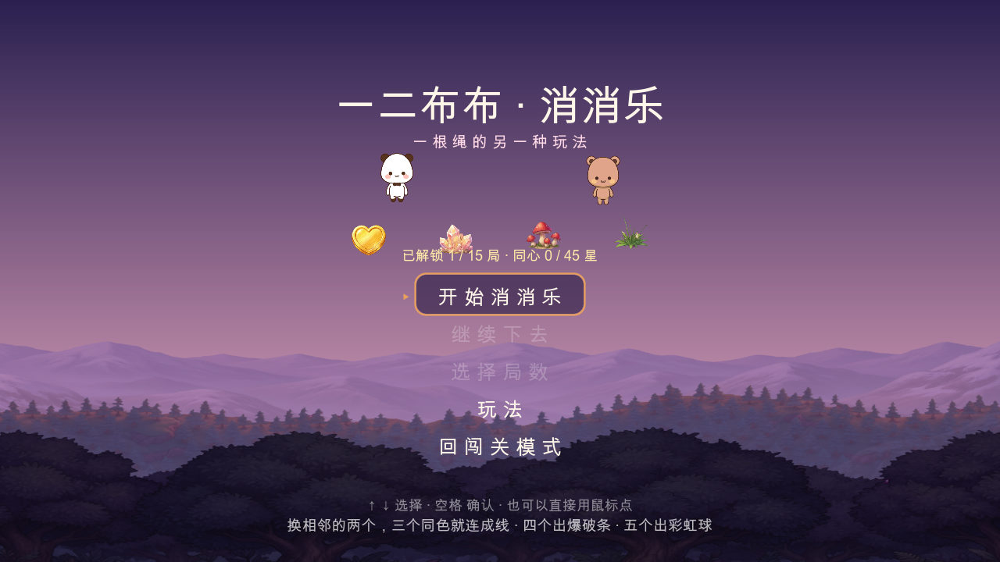
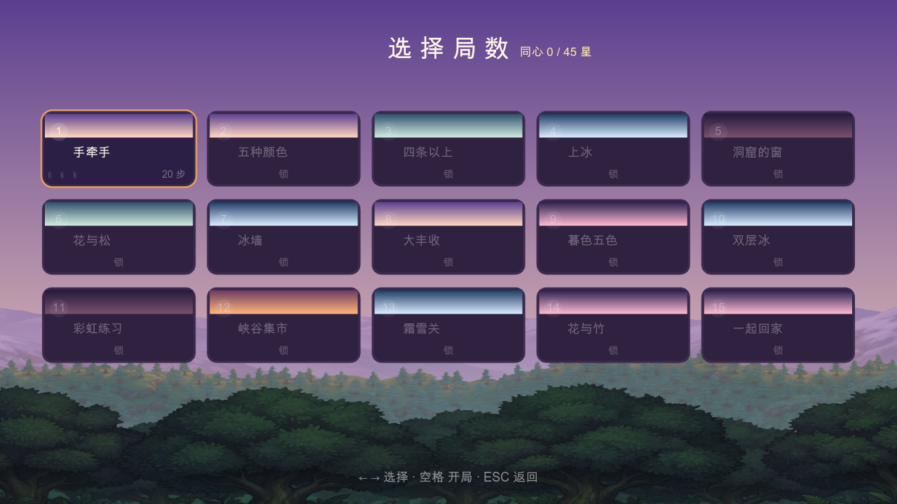
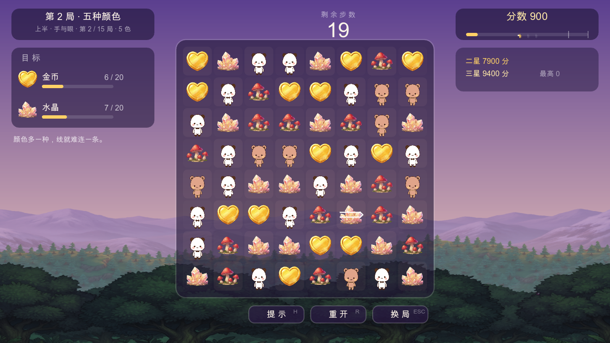
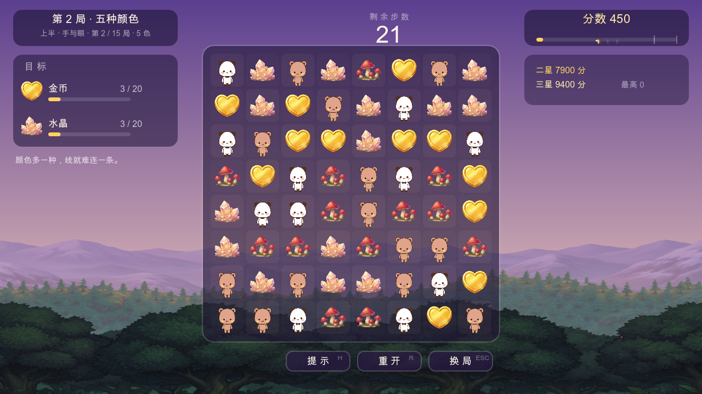
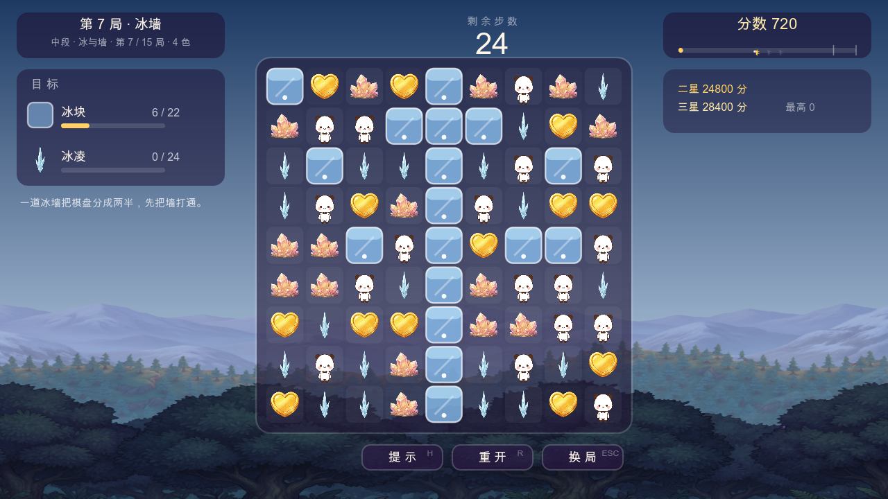
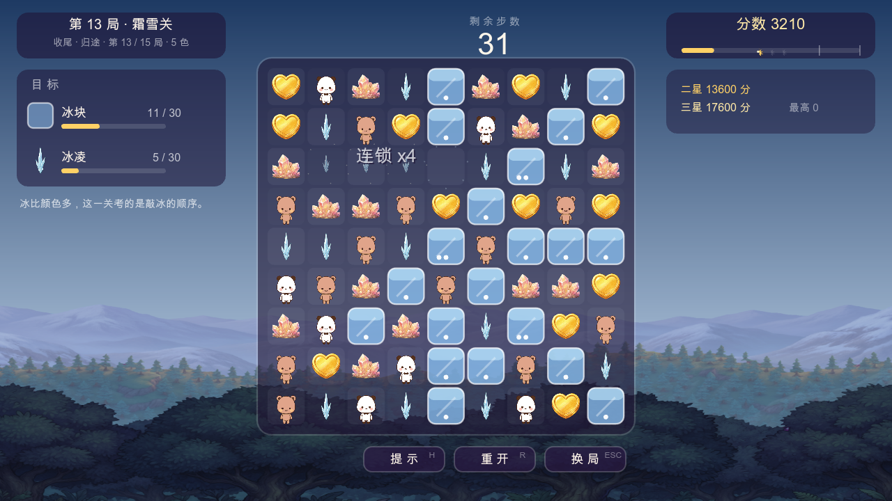

十五局的门槛不是拍脑袋定的：每局用固定种子跑 6 趟机器人通关，取**只统计通关局**的分数中位数当二星线、p90 当三星线，所以门槛一定落在"打得动的人真能打出来"的区间里。详见 [docs/游戏介绍.md](docs/游戏介绍.md)。

---

## 操作

| | 一二（白熊猫） | 布布（奶茶棕熊） |
| --- | --- | --- |
| 默认键位 | `A` / `D` 走，`W` 跳 | `←` / `→` 走，`↑` 跳 |
| 手柄 | 手柄 1：左摇杆/十字键走，`A` 跳 | 手柄 2 同理 |

全局：`ESC` 暂停菜单（继续 / 重开本关 / 设置 / 玩法教学 / 回到标题）· `P` 暂停 · `R` 重开本关（本关已吃的金币会退回去，不会变成刷分）· `M` 音效开关 · `F11` 或 `Alt+Enter` 全屏 · `空格` 确认（菜单也能直接鼠标点）。

**键位可改**：设置页里点一行（或走到那行按空格），再按一个键就绑上了；如果和另一边的键撞了，对面会自动挪到你原来那个键上，「恢复默认键位」随时退回。

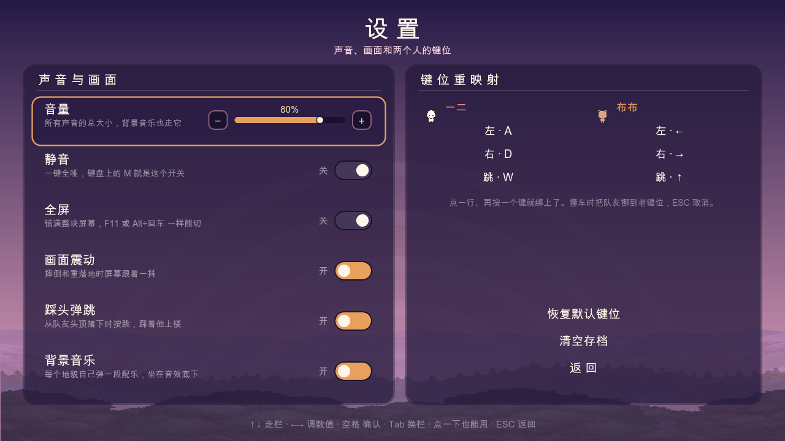
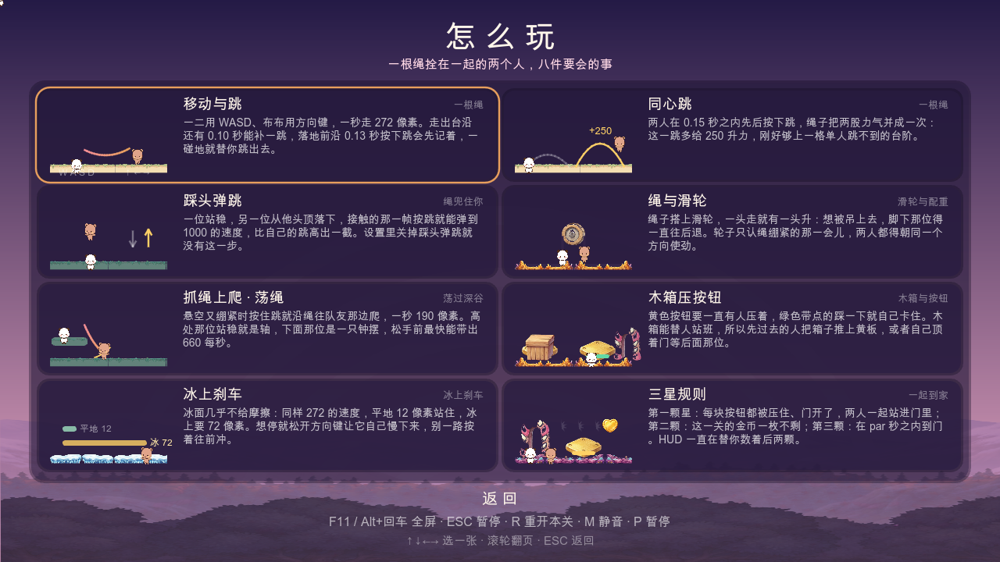
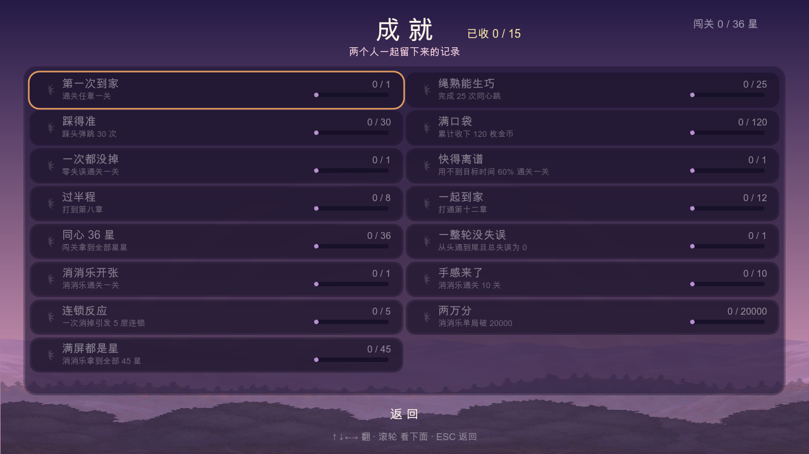

---

## 自己跑起来

### 直接玩

到 [Releases](https://github.com/huangwei-gem/yier-bubu/releases) 下载 `一二布布.exe`（单文件，约 111 MB），双击即可。拷给同学，对方双击也能玩，进度各自保存在自己电脑上。

### 用 Godot 打开工程

需要 **Godot 4.7.2**（Forward Plus / D3D12 / Jolt）。

```bash
git clone <本仓库>
# 用 Godot 编辑器 Import 这个目录，或命令行直接跑：
godot --path . res://scenes/main.tscn
```

导出单文件 exe（`export_presets.cfg` 已配好 `embed_pck=true`，并把 `tools/`、`assets/src/`、开发用插件排除在包外）：

```bash
godot --headless --path . --export-release "Windows Desktop" "../build/一二布布.exe"
```

---

## 工程结构

```
scenes/            一个 main.tscn，所有界面由代码挂上去
scripts/
  game.gd          autoload「Game」：模式/页面栈/存档/设置/键位/成就
  sfx.gd           autoload「Sfx」：全部音效与配乐当场合成，包里没有任何音频文件
  art.gd           贴图仓库：角色帧、场景画片、圆角矩形等绘制原语
  ui.gd            UI 原语：label / round_rect / pips / MenuNav / Buddy
  level_base.gd    关卡基类 + 数据驱动的关卡元素（尖牙/薄台/锯片/风柱/木箱/滑轮/传送带/冰面）
  player.gd tether.gd pads.gd moving_platform.gd backdrop.gd biomes.gd
  levels/          十二关，每关一个 DATA 字典
  match3/          消消乐：model.gd(纯规则) board.gd(表现) screens.gd(三个界面) levels.gd(十五局数据)
  pages.gd         设置页 / 成就页 / 玩法教学页
tools/             自检与烘焙工具（不进发布包）
assets/sprites/    烘好的角色帧
assets/env/        烘好的场景画片
docs/screens/      本 README 用的截图
```

架构上只有两条约定：**关卡与局都是数据**（`DATA` 字典 / `LEVELS` 数组），以及**界面全部在 `_draw()` 里画**（不用 `.tres` 主题、不用 Control 皮肤），所以两种玩法看起来是一个游戏做的。

---

## 自检闸门（改完必须全绿）

| 命令 | 管什么 |
| --- | --- |
| `godot --headless --path . res://tools/level_check.tscn` | 十二关数据齐全、元素可达、门与压力板对得上 |
| `godot --headless --path . res://tools/pages_smoke.tscn` | 设置/成就/教学三页与音频链路，115 项检查 |
| `godot --headless --path . res://tools/match3_check.tscn` | 消消乐规则（三连/特殊/连锁/冰/重排/落定不留空格）+ 十五局机器人胜率与门槛 |
| `godot --path . res://tools/match3_probe.tscn` | 窗口截图 + 真·合成鼠标拖动，39 张，并数像素确认棋子真的画出来了 |
| `godot --path . res://tools/play_probe.tscn` | 闯关模式自动跑完整轮，51 张截图 + 解锁链断言 |

三个 headless 闸门退出码非 0 就是没过；两个窗口探针会在最后打 `PROBE 截图=N 失败=0`。
探针会把玩家存档原样备份再还回去，跑测试不会污染进度（截图写到 `user://qa/`）。

---

## 存档位置

```
%APPDATA%\Godot\app_userdata\一二布布\yier_bubu.cfg
```

删掉即清零进度、星级、成就、键位和消消乐纪录；设置页里也有一项「清空存档」，效果一样。
旧版存档（只有闯关进度的那种）能被直接读，新增字段走默认值。

---

## 许可与免责

* 一二布布形象归属其版权方。本仓库内容**仅供个人学习与自娱**，不构成任何商用、发布、参赛授权；如需公开分发请先替换成原创形象。
* 代码部分（`scripts/`、`tools/`）以 MIT 方式提供，你可以自由学习、修改、用于自己的新项目；素材部分不在此授权范围内。
* 音乐与音效全部在程序里当场合成，仓库里没有音频文件，也不涉及第三方音源。
